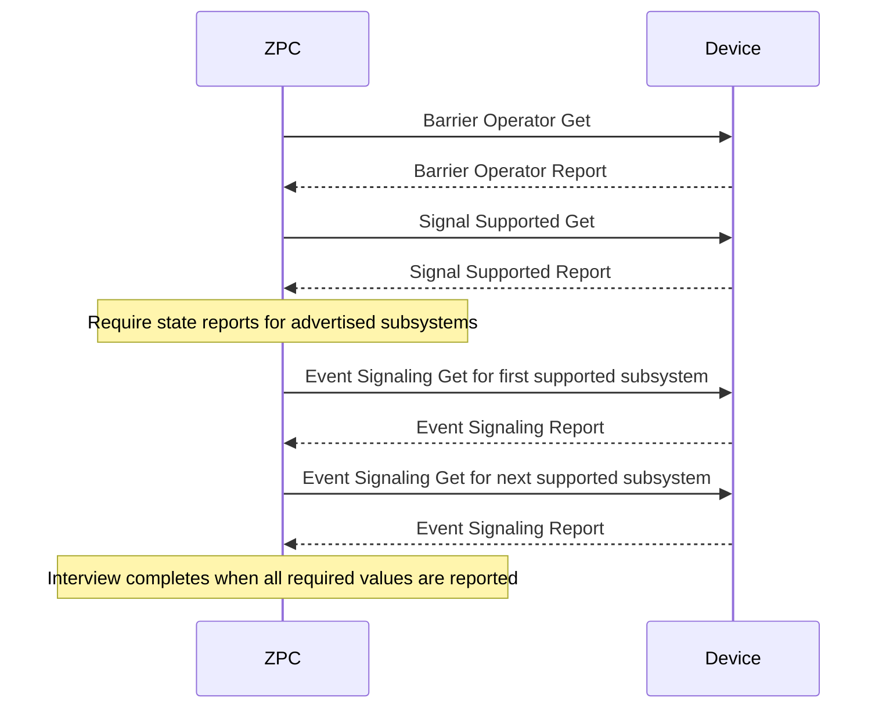

# Barrier Operator Command Class

This component controls and queries Barrier Operator v1 devices. It uses the command definitions in `scripts/command_class_generator/zwave.xml`; that file is unchanged.

The controller sends `Barrier Operator Set` and `Event Signal Set` requests from MQTT commands. It accepts Barrier Operator, signaling capability, and event signaling reports, stores reported values in the attribute store, and publishes the generated MQTT report topics.

The interview requests the barrier state and signaling capability mask. If the mask advertises audible or visual signaling, the interview requires and queries each supported subsystem state in order. Each report can reveal the next required report, and the generated report handler completes the interview after all required values arrive. Following the default activation recommendation in CL:0066.01.52.01.2, the controller sends Event Signal Set with state ON for every advertised subsystem, one at a time.

The CC is configured for control only with MQTT enabled and uses the network security scheme. It does not implement the supporting-device role.

