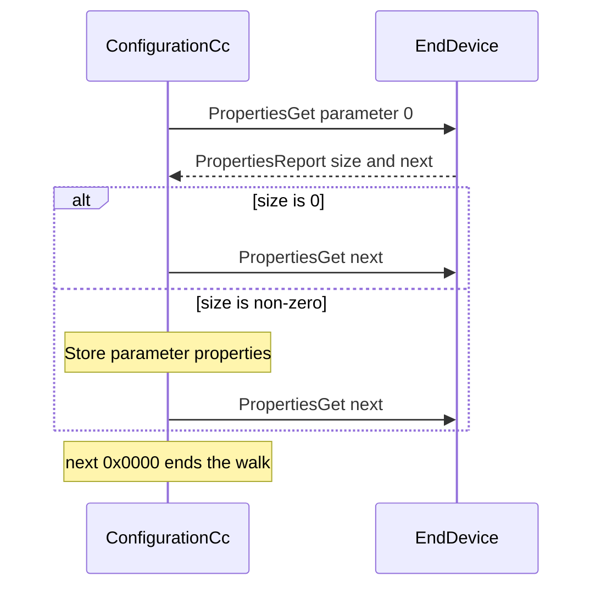

# Configuration Command Class (version 4)

Command Class ID: `0x70` (112 decimal)

## Overview

Control-only implementation. ZPC sends Configuration commands to end devices and stores parameter records. It does not answer Configuration commands as a supporting node.

For version 3 and later, interview starts a Properties Get walk at parameter 0. It follows each report's next-parameter number until the list terminates, then requests names and info for each supported nonzero parameter. Version 1 and 2 interviews do not scan parameters; their properties walk is marked complete without sending Configuration commands. The Version Command Class interview obtains the Configuration version before this flow starts.

## Supported Commands

| Command | ID | Direction | Notes |
|---|---|---|---|
| Configuration Set | 0x04 | TX | Parameter numbers 1-255 |
| Configuration Get | 0x05 | TX | Parameter numbers 1-255 |
| Configuration Report | 0x06 | RX | |
| Configuration Name Get | 0x0A | TX | 16-bit parameter number |
| Configuration Name Report | 0x0B | RX | UTF-8 fragments until Reports to Follow is 0 |
| Configuration Info Get | 0x0C | TX | 16-bit parameter number |
| Configuration Info Report | 0x0D | RX | UTF-8 fragments until Reports to Follow is 0 |
| Configuration Properties Get | 0x0E | TX | 16-bit parameter number |
| Configuration Properties Report | 0x0F | RX | |
| Configuration Default Reset | 0x01 | TX | Version 4 |
| Configuration Bulk Get/Set/Report | 0x07-0x09 | TX/RX | MQTT + frame assembly; Bulk Set skipped for read-only / no_bulk_support |

## Interview

For version 3+, the controller requests Properties Get for parameter 0, then follows `next_parameter_number` through the supported parameter list. After the walk ends, it requests Name Get for each discovered nonzero parameter, followed by Info Get for each. A next parameter number of 0 ends the walk. Versions 1-2 have no Properties Get walk and are marked complete without a parameter scan.

## Properties Walk (version 3+)

The interview and the MQTT command `ConfigurationPropertiesDiscover` use the same properties walk. After the walk, interview requests names and info for discovered parameters. On-demand discovery stops after the properties walk and marks discovery complete; it does not request names or info.



## On-demand Version 1-2 Parameter Scan

MQTT command: `ConfigurationParameterScan`

Recommended probe from CC:0070.01.00.22.001. For each parameter number 1 through 255, try sizes 1, 2, and 4 with a Configuration Set of value 0 followed by Configuration Get. Resolver give-up advances to the next size or parameter. This scan writes 0 into every parameter it finds.

If two or more parameters were found and the node is version 1–3, the scan continues with the default-bit probe and may set `default_resets_every_parameter`. Version 4 nodes skip that probe.

## Attribute Store Structure

```
Endpoint Node
├── discovery_complete
├── default_resets_every_parameter
├── properties_walk_active
├── parameter_scan_active
├── PARAMETER_ID (keyed by parameter number)
│   ├── size
│   ├── format
│   ├── min_value
│   ├── max_value
│   ├── default_value
│   ├── value
│   ├── name
│   ├── info
│   ├── read_only
│   ├── altering_capabilities
│   ├── advanced
│   └── no_bulk_support
├── CONFIGURATION_GET_GROUP
├── CONFIGURATION_SET_GROUP
├── CONFIGURATION_PROPERTIES_GET_GROUP
└── ...
```

## MQTT Commands

| Command | Purpose |
|---|---|
| ConfigurationGet | Read one parameter (1-255) |
| ConfigurationSet | Write one parameter; payload `parameter_number`, optional top-level `size`, `value`, optional top-level `default_flag` (omit `value` when using the default) |
| ConfigurationBulkGet | Read a consecutive parameter range (`parameter_offset`, `number_of_parameters`) |
| ConfigurationBulkSet | Write a consecutive range; payload includes `parameter_offset`, `number_of_parameters`, optional `properties1.size`, optional `handshake` / `default_flag`, and a `vg` array of `{ "parameter": [...] }` byte arrays. The array length must equal `number_of_parameters`, and each parameter byte array must match `size`. When `size` is omitted, ZPC uses the previously reported size for every parameter in the range; all must have a known, matching size. Set `default_flag` to 1 to restore defaults and omit `vg`. |
| ConfigurationNameGet | Read parameter name |
| ConfigurationInfoGet | Read parameter info |
| ConfigurationPropertiesGet | Read one parameter's properties |
| ConfigurationPropertiesDiscover | Walk parameter properties on versions 3+; completes with no properties on versions 1–2 |
| ConfigurationParameterScan | Version 1-2 size scan |
| ConfigurationDefaultReset | Reset all parameters (version 4) |
