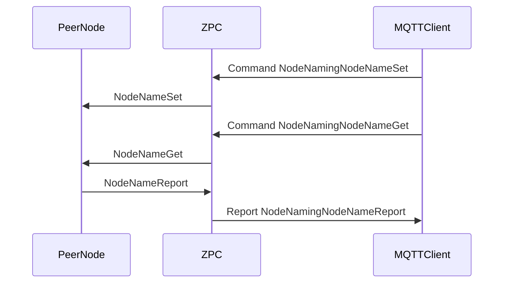

# COMMAND_CLASS_NODE_NAMING

ZPC controls Node Naming and Location (`0x77`, version 1) on remote nodes. MQTT
Name/Location Get and Set commands control those values on a selected node;
Name/Location Reports are stored and published over MQTT.

Character presentation values `0` (standard ASCII), `1` (extended ASCII), and
`2` (UTF-16) are accepted. Character fields are at most 16 bytes and are stored
as received without transcoding.

## Sequence

