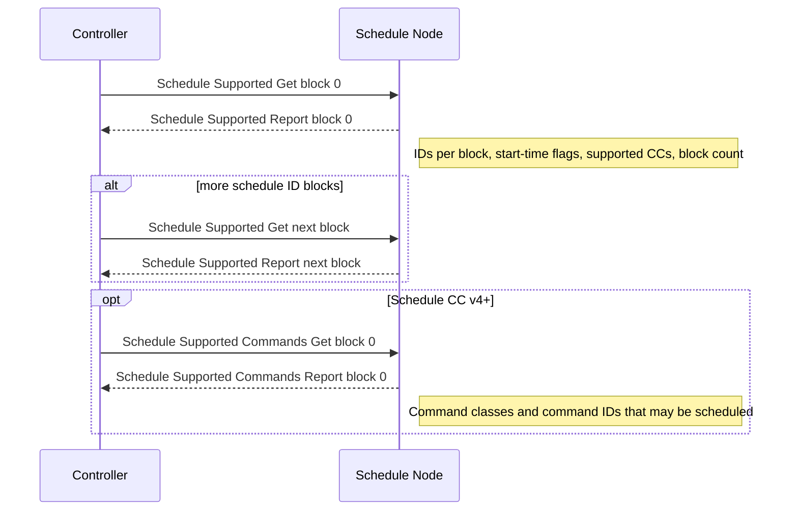
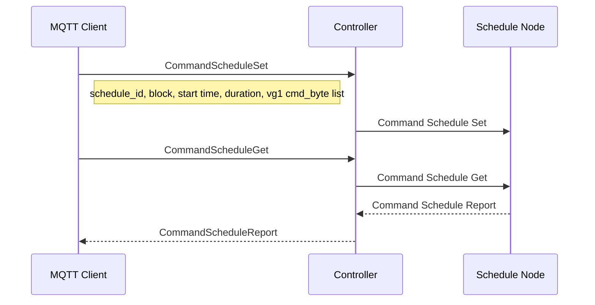

# Schedule Command Class (version 4)

Command Class ID: `0x53` (83 decimal)

## Overview

The Schedule Command Class version 4 schedules execution of other command-class commands on a supporting node for a given duration. This implementation is **control mode only**: ZPC sends Gets/Sets/Removes and publishes Reports over MQTT.

Version 4 is backwards compatible with versions 1–3 and adds Schedule Supported Commands Get/Report so a node can advertise which commands may be scheduled, including extended command classes.

## Supported Commands

| Command | ID | Direction | Description |
|---|---|---|---|
| Schedule Supported Get | 0x01 | TX | Query schedule capabilities for a schedule ID block |
| Schedule Supported Report | 0x02 | RX | Capabilities, supported CCs, override options, block count |
| Command Schedule Set | 0x03 | TX | Write a schedule entry and its command list |
| Command Schedule Get | 0x04 | TX | Read a schedule entry |
| Command Schedule Report | 0x05 | RX | Schedule entry contents |
| Schedule Remove | 0x06 | TX | Remove a schedule entry |
| Schedule State Set | 0x07 | TX | Enable/disable a schedule |
| Schedule State Get | 0x08 | TX | Query schedule state for a block |
| Schedule State Report | 0x09 | RX | Active schedule IDs and override state |
| Schedule Supported Commands Get | 0x0A | TX | Query commands that may be scheduled (v4) |
| Schedule Supported Commands Report | 0x0B | RX | List of schedulable command classes and commands |

## Interview Sequence

Interview queries schedule ID block 0 for Supported Report. On Schedule CC v4+, it also requires Supported Commands Report. If the Supported Report advertises more blocks, the controller requires the next block's Supported Report and sends the next Supported Get before the parsed callback returns. Individual schedule entries are not walked during interview; they are read or written through MQTT.



## MQTT Command Example (Set then Get)

Command payloads use the generated MQTT field names. Nested schedule commands are raw length-prefixed byte arrays (`cmd_byte`); ZPC does not decode the nested command class.



## Attribute Store Structure

Supported reports are stored per schedule ID block. Schedule entry payloads are published from the parsed frame and are not mirrored into the attribute store.

```
Endpoint Node
├── SCHEDULE_SUPPORTED_GET_GROUP
│   └── schedule_id_block
├── SCHEDULE_SUPPORTED_REPORT_GROUP (one per block)
│   ├── schedule_id_block
│   ├── number_of_supported_schedule_id
│   ├── start_time_support / fallback_support / support_enable_disable
│   ├── number_of_supported_cc
│   ├── vg1 (flat: supported_cc + properties2 per entry)
│   ├── supported_override_types / override_support
│   └── number_of_supported_schedule_blocks
├── SCHEDULE_SUPPORTED_COMMANDS_GET_GROUP
│   └── schedule_id_block
├── SCHEDULE_SUPPORTED_COMMANDS_REPORT_GROUP (one per block)
│   ├── schedule_id_block
│   ├── command_class_list_length
│   └── vg1 (flat: command_class, length, command bytes)
├── COMMAND_SCHEDULE_SET_GROUP / COMMAND_SCHEDULE_GET_GROUP
├── SCHEDULE_REMOVE_GROUP
└── SCHEDULE_STATE_SET_GROUP / SCHEDULE_STATE_GET_GROUP
```

## MQTT Interface

See the generated MQTT API: [command_class_schedule_mqtt_interface.md](generated/command_class_schedule_mqtt_interface.md).
