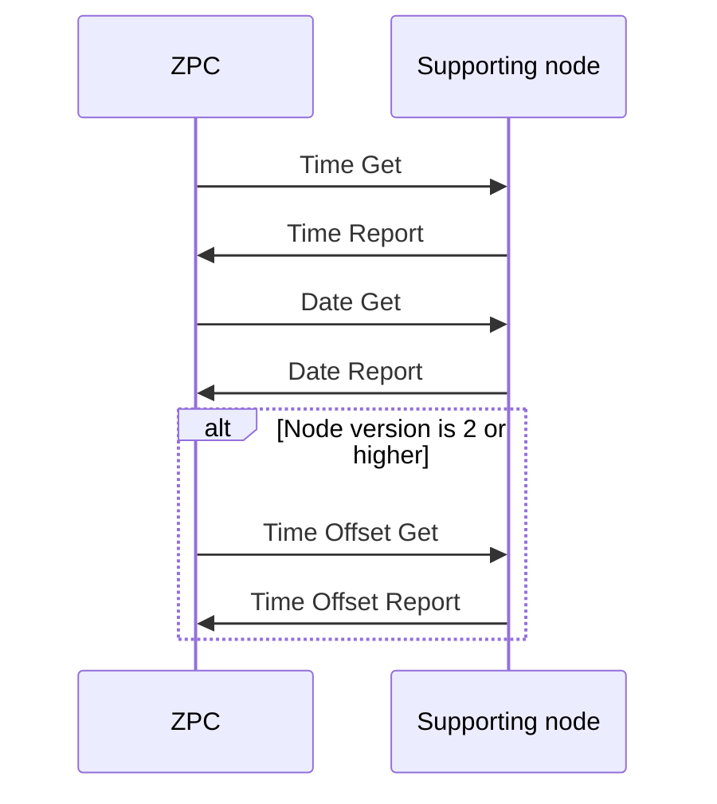
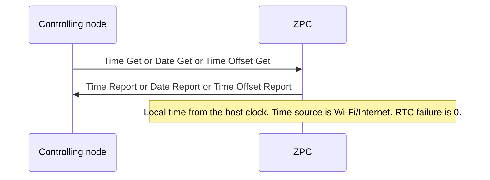

# Time Command Class (0x8A), version 3

ZPC is both a supporting and a controlling node for Time Command Class version 3.

As a supporting node it answers Time Get, Date Get, and Time Offset Get from the host clock. The host clock is a Wi-Fi/Internet time source, so Time Set, Date Set, Time Offset Set, and unsolicited Time Report do not change that clock (CC:008A.03.02.11.005, CC:008A.03.00.41.001). Set and Report commands are accepted only at ZPC's highest granted security class. Get commands are accepted at any security class (CC:008A.03.00.41.003).

As a controlling node, interview sends Time Get and Date Get, and Time Offset Get when the node reports version 2 or higher. Those Gets are unicast (CC:008A.01.01.11.002, CC:008A.01.03.11.002, CC:008A.02.06.11.002). Reports are stored on the sending node's endpoint. Time Set, Date Set, and Time Offset Set are sent when the matching attribute group has desired values inside the ranges required by the specification.

The controller sends an initial proactive Time Report to each interviewed Time CC endpoint, then sends another after 36 hours without a Time Get or a previous proactive report. It checks the host's daylight-saving state hourly and sends a report to all monitored endpoints when that state changes.

Version 1 and 2 Time Reports reserve the Time Source bits. Those bits are stored as Z-Wave. A 5-bit hour field of all ones is stored as 255, the specification's "time has not been set" value.

ZPC does not assign a dedicated Time association group during interview. A node with no Time association destination may send Time Get to its Lifeline destinations or to the SUC (CC:008A.03.00.32.001).

## Interview

## Support

