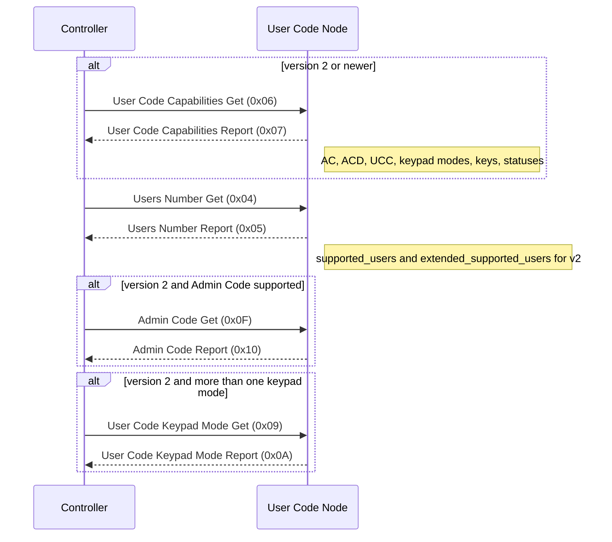

# User Code Command Class (version 2)

Command Class ID: `0x63` (99 decimal)

## Overview

The User Code Command Class manages PIN codes on access-control devices. This implementation is **control mode only**: ZPC acts as a controlling node and exposes MQTT commands and reports.

Version 2 is backwards compatible with version 1 and adds capabilities discovery, keypad mode, admin code, extended user identifiers, and checksum.

## Supported Commands

| Command | ID | Direction | Description |
|---|---|---|---|
| User Code Set | 0x01 | TX | Set or erase a user code (v1 range) |
| User Code Get | 0x02 | TX | Query a user code (v1 range) |
| User Code Report | 0x03 | RX | Receives a user code report |
| Users Number Get | 0x04 | TX | Query supported user count |
| Users Number Report | 0x05 | RX | Receives supported user count |
| User Code Capabilities Get | 0x06 | TX | Query v2 capabilities |
| User Code Capabilities Report | 0x07 | RX | Receives v2 capabilities |
| User Code Keypad Mode Set | 0x08 | TX | Set keypad mode |
| User Code Keypad Mode Get | 0x09 | TX | Query keypad mode |
| User Code Keypad Mode Report | 0x0A | RX | Receives keypad mode |
| Extended User Code Set | 0x0B | TX | Set or erase extended user codes |
| Extended User Code Get | 0x0C | TX | Query extended user codes |
| Extended User Code Report | 0x0D | RX | Receives extended user codes |
| Admin Code Set | 0x0E | TX | Set or deactivate admin code |
| Admin Code Get | 0x0F | TX | Query admin code |
| Admin Code Report | 0x10 | RX | Receives admin code |
| User Code Checksum Get | 0x11 | TX | Query user code checksum |
| User Code Checksum Report | 0x12 | RX | Receives user code checksum |

## Interview Sequence

Interview follows the control specification mandatory interview (CL:0063.01.21.01.2). Per-user code Gets are not part of the interview gate; use MQTT Get commands instead.



## Attribute Store Structure

```
Endpoint Node
├── USERS_NUMBER_GET_GROUP
├── USERS_NUMBER_REPORT_GROUP
│   ├── supported_users
│   └── extended_supported_users
├── USER_CODE_CAPABILITIES_GET_GROUP
├── USER_CODE_CAPABILITIES_REPORT_GROUP
│   ├── supported_user_id_status_bit_mask_length
│   ├── acd_support
│   ├── ac_support
│   ├── supported_user_id_status_bit_mask
│   ├── supported_keypad_modes_bit_mask_length
│   ├── mucs_support
│   ├── mucr_support
│   ├── ucc_support
│   ├── supported_keypad_modes_bit_mask
│   ├── supported_keys_bit_mask_length
│   └── supported_keys_bit_mask
├── USER_CODE_KEYPAD_MODE_GET_GROUP
├── USER_CODE_KEYPAD_MODE_REPORT_GROUP
│   └── keypad_mode
├── ADMIN_CODE_GET_GROUP
└── ADMIN_CODE_REPORT_GROUP
    ├── admin_code_length
    └── admin_code
```

Individual user codes are not stored in the attribute store. MQTT reports publish them from the parsed frame.

## MQTT Interface

See [generated MQTT interface](generated/command_class_user_code_mqtt_interface.md).
