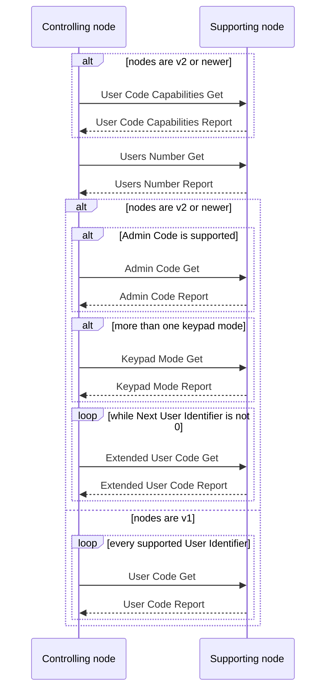

# User Code Command Class

Controlling node for User Code, versions 1 and 2. ZPC interviews a supporting node and sends the end-user Set commands from the 2026B specification. It does not implement the supporting side.

A version 2 interview follows the User Code interview figure:

1. User Code Capabilities Get
2. Users Number Get
3. Admin Code Get when Admin Code support is set
4. Keypad Mode Get when more than one keypad mode is set
5. Extended User Code Get, starting at user identifier 1, while the reported Next User Identifier is not 0

Report More is 1 only when Multiple User Code Report support is set. A version 1 interview sends Users Number Get, then User Code Get for each supported user identifier starting at 1.

When the Node Info also contains User Credential, User Code waits for User Credential to report its supported user count. A count of 0 starts the User Code interview above. A count above 0 ends User Code without Gets. User Credential owns the count value; User Code registers it as an interview dependency so the combined interview stays open until the decision is made.

User Code Set to a version 2 peer is sent as Extended User Code Set. The same command to a version 1 peer stays User Code Set. Keypad Mode Set, Admin Code Set, a user identifier above the stored total, and a multi-block set are refused only when stored capabilities or the stored user total say the peer cannot accept them. An Available User Code of four `0x00` bytes is stored as those four bytes.

The daily checksum check is not implemented. A checksum report is stored, and Checksum Get is refused when stored checksum support is absent.

