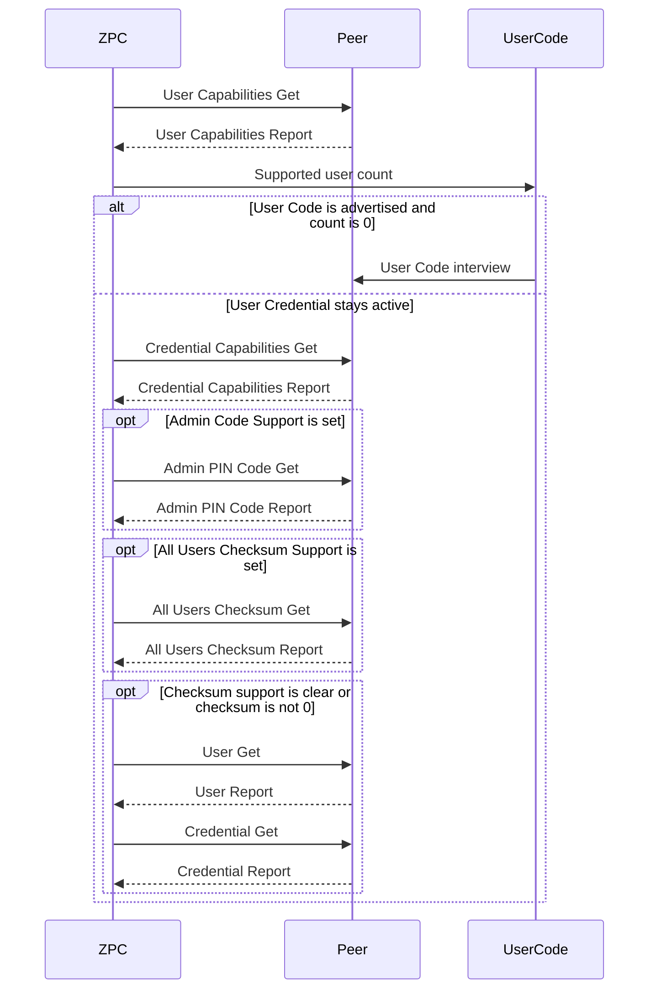

# User Credential Command Class

Controlling-node implementation of User Credential Command Class version 1. ZPC does not implement the supporting side.

## Interview

The interview follows the User Credential version 1 specification.

1. User Capabilities Get is always first.
2. When the Node Info also contains User Code and the supported user count is 0, User Credential stops. User Code continues its own interview.
3. Otherwise Credential Capabilities Get follows.
4. When Admin Code Support is set, Admin PIN Code Get is issued and its report is required to complete the interview.
5. When All Users Checksum Support is set, All Users Checksum Get follows. A checksum of 0 ends the user and credential scan. Any other checksum, or a clear support bit, starts User Get at identifier 0.
6. Each User Report is followed by Credential Get for that user, starting at credential type 0 and slot 0. Non-zero Next Credential fields continue the walk. A non-zero Next User Unique Identifier starts the next user.

Starting the walk removes the users and credentials stored by an earlier interview. Each user is stored once per user identifier, and each credential once per user, credential type, and slot. Credential Checksum Reports are stored per credential type.

User Code waits for the supported user count when the Node Info contains User Credential. If User Capabilities Get is never answered, both interviews end when the interview give-up timeout expires.

Per-user checksums are not part of the interview. They are available as MQTT Get commands.

When User Schedule Support is set, each interviewed user publishes `COMMAND_CLASS_USER_CREDENTIAL_INTERVIEW_USER_SCHEDULE` with target command class `0x83` and that user identifier. Active Schedule frames are not sent from this component.

## Validation

Outgoing Set and Get commands are checked against stored capabilities. A missing capabilities report does not refuse a command. A stored zero or absent capability does.

User Set accepts Add, Modify, and Delete, including delete-all at user identifier 0. A non-zero expiring timeout is accepted only for an Expiring user. The name encoding must be one the peer advertised, and a UTF-16 name must have an even length.

Credential Set accepts a type and slot from Credential Capabilities. PIN data is digits within that type's minimum and maximum length. Delete-all for one credential type uses user identifier 0, credential slot 0, and a non-zero type.
